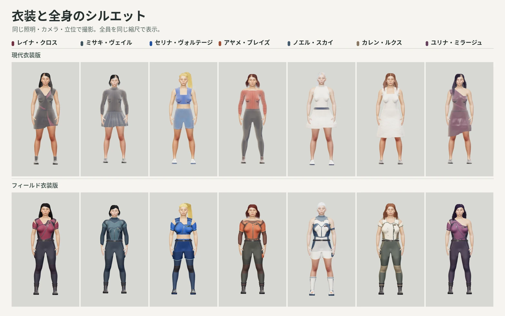
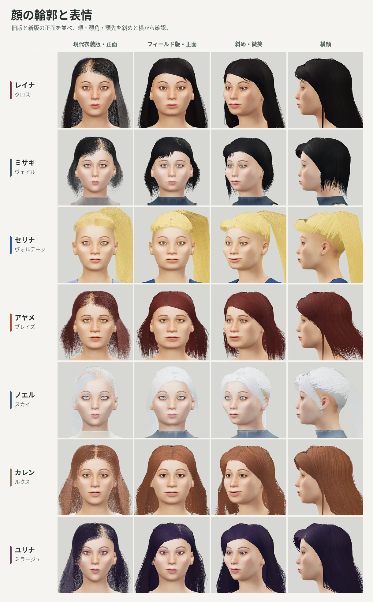
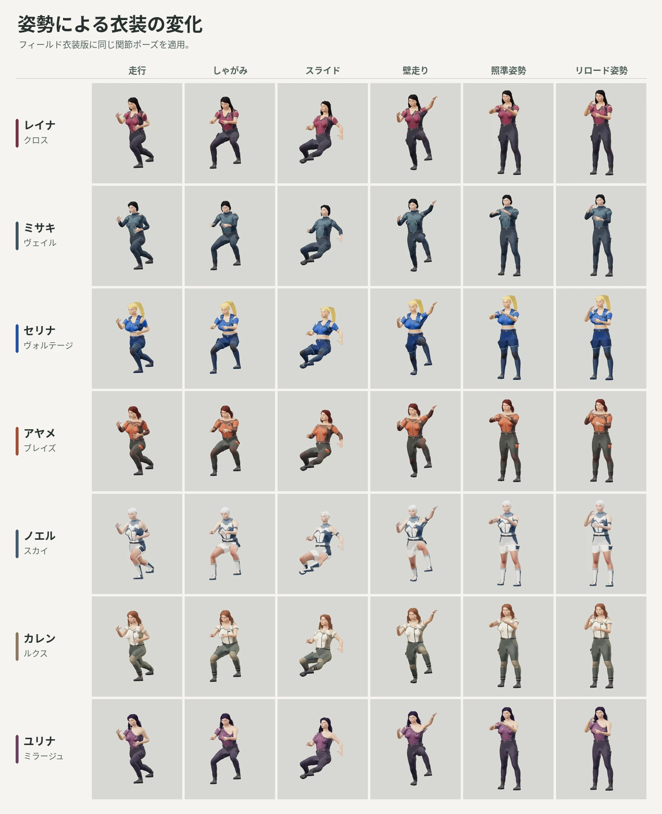

# PROJECT VELOCITY フィールド衣装版

成人キャラクター7人の編集用GLB。現代衣装にあったラップ、プリーツ、スポーツウェア、サテンの斜線を、それぞれの短い上着や脚ごとに曲がるボトムに取り入れた。髪色と毛流れは元モデルから引き継ぎ、耳から頬にかかる毛束を整えた。各ファイルにはテクスチャ、163関節の骨格、元の待機アニメーション「Idle」が入っている。



| キャラクター | 外見と裁断 | GLB |
| --- | --- | ---: |
| レイナ・クロス | 頬から顎角をなだらかにつなぎ、肩に丸みを加えた。ラップの斜線を短い前合わせとファスナーに移した。 | [7.62 MiB](reina_cross.glb) |
| ミサキ・ヴェイル | 小ぶりの顎先とふっくらした頬に、細めの肩線を合わせた。プリーツをベストの腰まわりに収めた。 | [7.58 MiB](misaki_veil.glb) |
| セリナ・ヴォルテージ | 頬骨と肩幅を少し強めた。クロップ丈とコバルトの切り替えを残し、左右のショーツ裾を別々に動かせる。 | [7.95 MiB](selina_voltage.glb) |
| アヤメ・ブレイズ | 顎角と肩の厚みを7人で最も強く残した。長袖に袖口を重ね、膝の切り替えと片腿のマチ付きポケットを付けた。 | [7.55 MiB](ayame_blaze.glb) |
| ノエル・スカイ | 頬と顎先に丸みを持たせ、脚の輪郭が出るショーツとライン入りソックスにした。テニス衣装の配色を受け継いでいる。 | [7.73 MiB](noel_sky.glb) |
| カレン・ルクス | 角を落とした顎にやわらかい腰とヒップのラインを合わせた。スクエアネックの下に二列の留め具を並べた。 | [7.70 MiB](karen_lux.glb) |
| ユリナ・ミラージュ | すっきりした頬から丸い顎先につなぎ、横から見たヒップに厚みを加えた。片肩のラインを斜め合わせのベストへ続けた。 | [7.46 MiB](yurina_mirage.glb) |

## 顔とシルエット

顔の比較は同じカメラと照明を使った。各行は左から、現代衣装版の正面、フィールド版の正面、微笑した斜め顔、横顔。顎角の幅、顎先の高さと奥行き、頬と口元のつながりを確認できる。



[横・斜め後ろから見た全身](previews/silhouettes.webp)では、短い裾、腰からヒップへのライン、腿の外側に寄せたポケットの位置を確認できる。

## 姿勢と動き

走行、しゃがみ、スライド、壁走り、照準、リロードを想定して、7人の同じ関節に6種類の確認用ポーズを適用した。裾は左右の腿に分け、膝の当て布と袖は下の生地のウェイトに合わせた。長い髪の毛先には首と上背のウェイトも配分した。



動作中の接触はモーションの軌道と小物の寸法にも依存する。ゲーム用の移動・戦闘モーションと手持ちモデルとの通し確認は、それらを組み込む段階で行う。

## 手元で比較する

リポジトリのルートで `npm ci` と `npm run dev` を実行し、表示された開発サーバーのURLに `/scripts/characters/review.html` を付けて開く。人物、衣装、姿勢、表情、カメラを切り替えられる。ドラッグで回転、ホイールやピンチで拡大できる。GLBはBlenderにも直接読み込める。

## 容量と動作確認

7体合計は53.58 MiB（現代衣装版は374.50 MiB）。1体あたり135,494～143,625三角形。7体をBlender 4.3.2とThree.js r180で読み込み、Khronos glTF Validatorで全ファイルのエラー・警告が0件であることを確認した。

## 再生成と検証

Python環境に制作用の依存関係を入れてから再生成する。

```bash
python -m pip install -r scripts/characters/requirements.txt
python scripts/characters/build_field.py
node scripts/characters/verify.mjs
```

検証スクリプトは7ファイルの容量とSHA-256に加えて、現代衣装版と関節名、逆バインド行列、Idleの対象・時刻・キーフレーム値が一致することを確認する。

[モデル一覧とSHA-256](models.json) · [現代衣装版](../female_everyday/README.md) · [制作前のレビュー](../../../../docs/character-art-review.md)

人体のベース、骨格、肌と目の元データは[MakeHumanのCC0素材](https://github.com/Makehuman-2/MH2_Asset_Repository_CCO)。元の7体の顔、髪のガイド、衣装から、フィールド版の輪郭、布地、パネル、ウェイト、髪束を組み直した。
